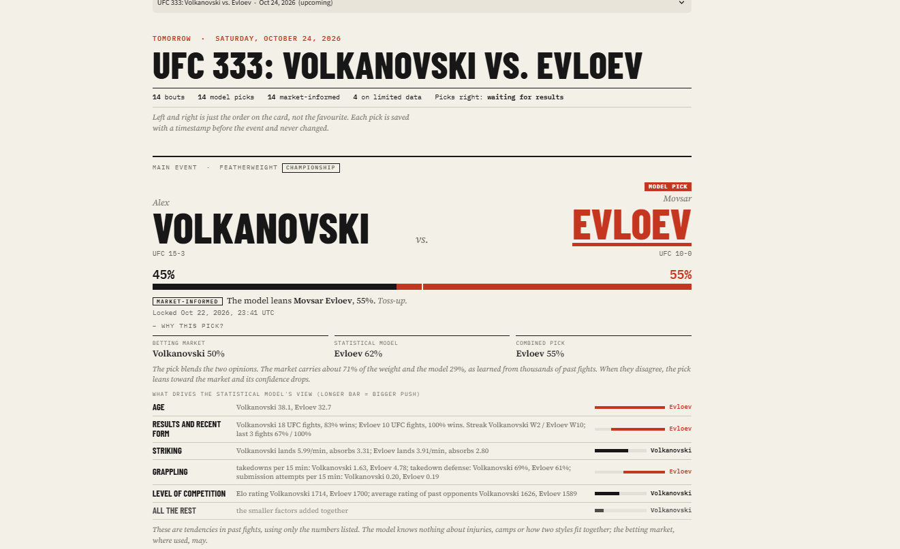
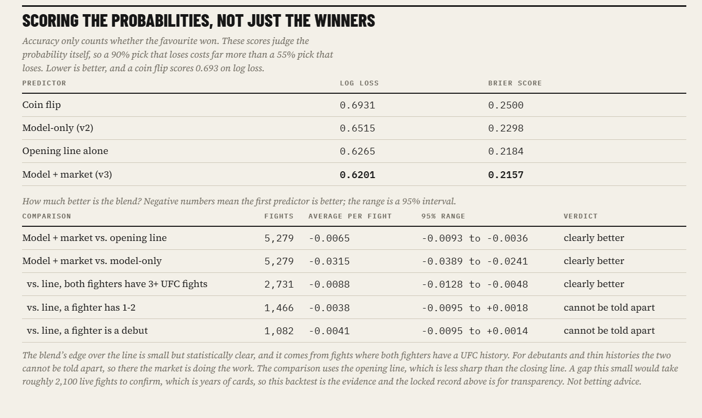
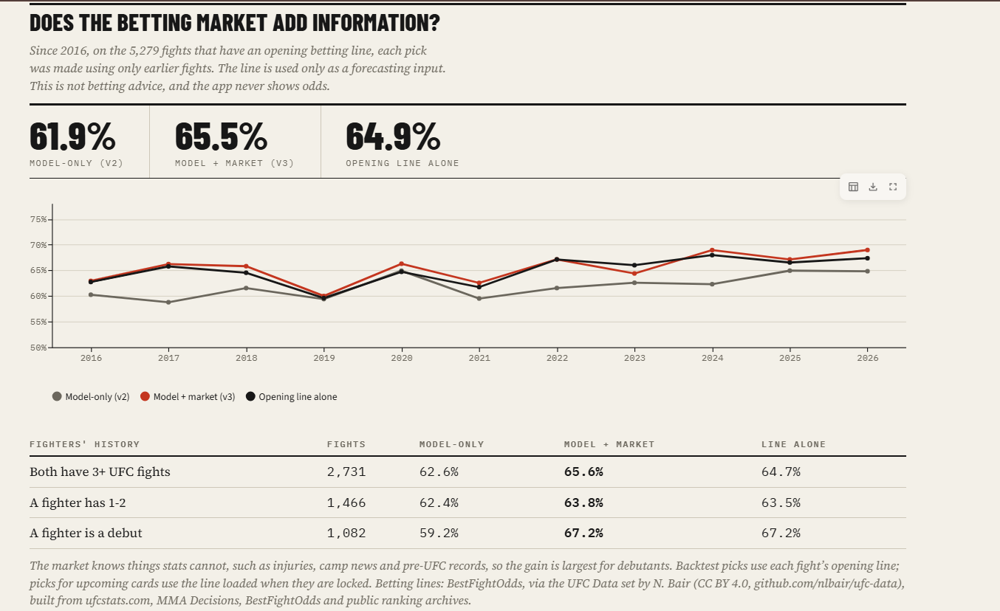
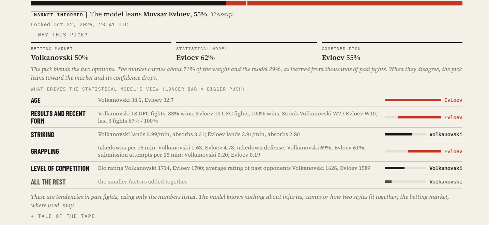
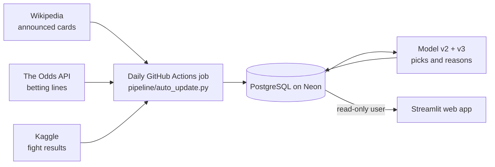
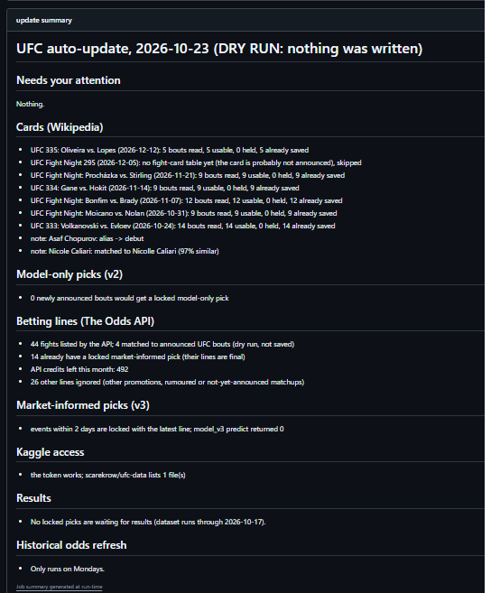

<!-- Numbers and tables inside generated markers come from the database (pipeline/readme_numbers.py). Edit the prose freely, but not between the markers. -->

# UFC Fight Predictor

A web app that predicts UFC fights **before they happen**, locks each pick with a timestamp, explains it in plain language, and grades itself against the real results. A daily job keeps it running: it loads newly announced cards, locks picks, and grades finished events.

**Live app: https://ufc-predictor.streamlit.app/**

**No accounts? [Run the demo in two minutes](demo/README.md):** the real pipeline, models and website, running on invented fighters (`python demo/run_demo.py`).

> Independent project, not affiliated with the UFC. Predictions are for fun and learning, not betting advice. The app never shows betting odds.

## At a glance

| | |
|---|---|
| **What it does** | Picks a winner for every UFC fight, past and upcoming, and shows the reasoning behind each pick |
| **Best result** | **<!--n:acc_v3-->65.4%<!--/n-->** of <!--n:n_fights-->5,279<!--/n--> fights picked correctly (<!--n:first_year-->2016<!--/n--> to <!--n:last_year-->2026<!--/n-->), every pick made using only data from before that fight. A coin flip is 50% |
| **Also predicts** | The chance each fight goes the distance, with its own honest backtest and predictions locked before the event; a second version also uses the betting line (added on a narrow margin, tracked alongside) |
| **Friends' game** | A private "beat the model" game: friends pick the winner, method and round before a card and are scored against the model |
| **Demo** | One command runs the whole project on invented fighters, with no accounts or credentials: the real pipeline builds a private database and the real website opens on it |
| **Stack** | Python (pandas, scikit-learn), PostgreSQL on Neon, SQL window functions, Streamlit, GitHub Actions |
| **Automation** | A daily job reads announced cards (Wikipedia), betting lines (The Odds API) and results (Kaggle) |
| **Safety** | <!--n:n_tests-->251<!--/n--> offline tests run before every scheduled job, a dry-run mode, and a read-only database user behind the public app |
| **Transparency** | Every locked pick and goes-the-distance prediction is also published to a [public, time-stamped log](picks_log/ABOUT.md) in this repository |
| **Cost** | Free tiers only |

## What this project is really about

Most fight-prediction projects end with a notebook and one accuracy number. This one tries to answer a harder question: **how would I know that number is real?**

- **Time-honest evaluation.** Every pick, past or future, uses only information that existed before the event, and I check that by recomputing features the slow way and by walking forward year by year.
- **A locked record.** Picks for upcoming cards are saved with a timestamp before the event and can never be changed. The site's Track record page grades them.
- **Explanations that are exact.** The model is a sum, so each pick can be split into reasons that add up to the pick, and a reason is only saved if it reproduces the stored probability.

## Results, honestly

All rows are measured on the **same <!--n:n_fights-->5,279<!--/n--> fights (<!--n:first_year-->2016<!--/n--> to <!--n:last_year-->2026<!--/n-->)**, each predicted from earlier fights only.

<!--auto:results_accuracy-->

| Predictor | Right |
|---|---|
| Coin flip | 50% |
| Statistical model alone (v2) | 61.8% |
| Bookmakers' opening line alone | 64.9% |
| **Statistical model + the betting market (v3)** | **65.4%** |

<!--/auto:results_accuracy-->

The market-informed model helps most where the statistics are thinnest:

<!--auto:results_tiers-->

| Fighters' UFC history | Fights | Model alone | Model + market |
|---|---|---|---|
| Both have 3+ UFC fights | 2,731 | 62.6% | 65.7% |
| The less experienced has 1 to 2 | 1,466 | 62.3% | 63.8% |
| A fighter is a debutant | 1,082 | 59.2% | 67.2% |

<!--/auto:results_tiers-->

**How to read this honestly**

- **The market is doing most of the work.** The blend puts about <!--n:market_weight-->71%<!--/n--> of its weight on the betting market and <!--n:model_weight-->29%<!--/n--> on my model. The model alone is still a legitimate <!--n:acc_v2-->61.8%<!--/n--> predictor, but I would not claim to beat the bookmakers on my own. Scoring the probabilities (below) shows the model does add a small amount on top of the line.
- **The probabilities are honest.** The calibration table below compares each stated confidence with how often those picks were right; the two track each other closely, and the most confident picks were not over-confident.
- **The market and the model disagree on <!--n:dis_share-->25.5%<!--/n--> of fights.** In those fights the blended pick was right <!--n:dis_blend-->57.1%<!--/n--> of the time and the model-only pick <!--n:dis_model-->42.9%<!--/n-->, which is the clearest evidence the market adds information the statistics do not have.
- **The backtest uses opening lines.** Live picks lock two days before an event using that day's line, so I expect results between the opening-line figure above and the closing-line figure (67.0% for the line alone, 67.6% blended), not better than either.
- **One card is noise.** A card has 10 to 14 fights, so a single event can land anywhere. Across years with at least <!--n:year_min_fights-->200<!--/n--> scored fights, the model's yearly accuracy ranges from about <!--n:year_lo-->55%<!--/n--> to <!--n:year_hi-->65%<!--/n-->.

**Calibration:** for the market-informed picks, how often they were right at each stated confidence.

<!--auto:calibration-->

| Stated confidence | Fights | Average stated | Actually right |
|---|---|---|---|
| 50 to 60% | 1,575 | 55.2% | 55.0% |
| 60 to 70% | 1,854 | 65.0% | 61.8% |
| 70 to 80% | 1,353 | 74.5% | 74.7% |
| 80% and up | 497 | 84.7% | 86.9% |

<!--/auto:calibration-->

### Scoring the probabilities, not just the winners

Accuracy only counts whether the favourite won, which is a blunt tool: 65.4% against 64.9% cannot separate the blend from the line. Log loss and Brier score judge the probability itself, so a 90% pick that loses costs far more than a 55% pick that loses (lower is better; a coin flip scores 0.693 on log loss). Same <!--n:n_fights-->5,279<!--/n--> fights:

<!--auto:scoring_table-->

| Predictor | Log loss | Brier score |
|---|---|---|
| Coin flip | 0.6931 | 0.2500 |
| Statistical model alone (v2) | 0.6515 | 0.2298 |
| Bookmakers' opening line alone | 0.6265 | 0.2184 |
| Model + market (v3) | **0.6201** | **0.2157** |

<!--/auto:scoring_table-->

<!--auto:scoring_compare-->

| Model + market compared with... (log loss per fight; negative means it is better) | Fights | Average | 95% range | Verdict |
|---|---|---|---|---|
| The opening line | 5,279 | -0.0065 | -0.0093 to -0.0036 | clearly better |
| The model alone | 5,279 | -0.0315 | -0.0389 to -0.0241 | clearly better |
| The opening line, where both fighters have 3+ UFC fights | 2,731 | -0.0088 | -0.0128 to -0.0048 | clearly better |
| The opening line, where a fighter has 1 to 2 | 1,466 | -0.0038 | -0.0095 to +0.0018 | cannot be told apart |
| The opening line, where a fighter is a debutant | 1,082 | -0.0041 | -0.0095 to +0.0014 | cannot be told apart |

<!--/auto:scoring_compare-->

The blend beats the opening line by a small but statistically clear amount (first row of the second table), and the edge comes from fights where both fighters have a UFC history. For debutants and thin histories the blend and the line cannot be told apart, so there the market is doing the work. Two caveats: this is against the *opening* line, which is less sharp than the closing line, and a gap this small would take roughly <!--n:n_live_needed-->2,100<!--/n--> live fights to confirm, so the backtest is the evidence and the live record is for transparency. Every number and table in this section and the one above is generated from the database by `python pipeline/readme_numbers.py update`, and the Track record page shows the same tables live.

## A second question: will the fight go the distance?

Besides picking a winner, the app estimates the chance that each fight **goes to a decision**. It uses only how long these two fighters' earlier fights lasted (the share of the scheduled time they used, how often they went to a decision, how often they won or lost by a finish) and whether it is a title fight or five rounds. It was built the same honest way as the winner model: every prediction uses only earlier fights, upcoming ones are locked before the event and published to the public log, and the test is a walk-forward over <!--n:dist_n-->8,180<!--/n--> fights (<!--n:dist_first_year-->2006<!--/n--> to <!--n:dist_last_year-->2026<!--/n-->), each predicted by a model trained on earlier fights only. AUC is the chance that a fight that went the distance was given a higher probability than one that did not (0.5 is chance).

<!--auto:distance_table-->

| Predictor | Log loss | Brier score | AUC |
|---|---|---|---|
| Coin flip | 0.6931 | 0.2500 | 0.500 |
| Plain decision rate of the previous three years | 0.6918 | 0.2493 | 0.512 |
| **Goes-the-distance model** | **0.6689** | **0.2381** | **0.625** |

<!--/auto:distance_table-->

The model beats the plain decision rate of the previous three years by **<!--n:dist_gain-->0.0229<!--/n--> log loss per fight** (95% interval <!--n:dist_gain_lo-->0.0179<!--/n--> to <!--n:dist_gain_hi-->0.0278<!--/n-->), was better in <!--n:dist_years_better-->19<!--/n--> of <!--n:dist_years_total-->21<!--/n--> years, and its probabilities were within <!--n:dist_gap-->3.4<!--/n--> points of what happened in every large bucket. I tested richer versions (weight class, age, ratings, striking and grappling styles, gradient boosting) and none helped: the signal is how long these fighters' fights tend to last. Before trusting the result I checked it for leaks the way I did for the winner model: the counts were recomputed by brute force for 300 random fights, and a placebo with the answers shuffled drops to chance (AUC 0.500).

### Adding the betting market, on a narrow margin

The distance model hedges toward "about half" for everyone, but lopsided fights end early far more often than that: in six thousand fights with lines, a fight where the favourite was at 80% or more went to a decision about a third of the time, against about half for a toss-up. So I tested whether adding **how strong the favourite is on the betting line** helps, with the rule for what counts as a yes written into the script **before** I saw a result (`pipeline/experiment_distance_market.py`). It passed, but only just: a gain of about 0.003 log loss, with the low end of its 95% interval a hair above zero. That is not enough to replace anything, so the market-informed prediction runs **alongside** the original: both are locked before each event, both are in the public log (`picks_log/locked_distance_market.csv`), and the live record decides whether the line earns its place. The website shows the original as the headline and the market-informed figure beside it. No odds are shown anywhere.

On the <!--n:dist2_n-->5,763<!--/n--> past fights with a line (<!--n:dist2_first_year-->2014<!--/n--> to <!--n:dist2_last_year-->2026<!--/n-->), each predicted from earlier fights only, the market-informed prediction averages **<!--n:dist2_gain-->0.0028<!--/n--> log loss per fight better** than the model-only one and was better in <!--n:dist2_years_better-->10<!--/n--> of <!--n:dist2_years_total-->12<!--/n--> years, but its 95% range (<!--n:dist2_gain_lo-->-0.0002<!--/n--> to <!--n:dist2_gain_hi-->+0.0059<!--/n-->) includes zero, so on past fights alone the two **cannot be told apart**. That is what a small effect looks like, and it is why both are tracked: whether the improvement is real is exactly what the live record is for, and a few cards say nothing either way.

## A game for friends: beat the model

The site has a private game. Friends join with an invite code and pick, for each fight on the **next card**, the **winner, how it ends and the round**. Picks close 6 hours before the card's first fight (the following card then opens), and other players' picks stay hidden until then. The page is built in the site's own style, and clearing a pick on screen clears it in the database, so what you see is what is saved. Two leaderboards follow once the results are in:

- **Beat the model:** your result minus the model's, on the winner call and on goes-the-distance (a Decision pick means "goes the distance"). +1 if you are right and the model is wrong, -1 if the reverse, 0 otherwise. Copying the model scores exactly 0, so the only way up is to disagree with it and be right.
- **Points:** winner +1, method +1, round +1.

It is the first feature where the public site writes to the database, so it is built defensively. The game uses its **own database user that can touch only its three tables**; the site's read-only user is deliberately stopped from reading them, so PIN hashes stay private. PINs are stored only as salted scrypt hashes, and wrong PINs and wrong invite codes are throttled in the database, not in the page. Every pick is validated again on the server (the right fighters, a card that is still open, a valid round), and everything shown is HTML-escaped. The permissions are tested against a real Postgres server on every push, an `audit` command checks the live database, and I deliberately broke the key protections (escaping, hidden picks, the cutoff, the lockout) to check that the tests fail when they should. The Discord digest also posts a reminder a few hours before a card's picks close (how many players have picked, never who picked what) and, once every result is in, a leaderboard with scores only. Nothing is wagered, and the only data kept is a nickname, a hashed PIN and the picks.

## The mistakes it caught

The most useful part of this project was catching results that looked good and were not.

1. **Career stats were snapshots of today.** The raw dataset's career stats were identical on a veteran's 2008 row and his 2026 row, so using them would have leaked the future. I rebuilt every rolling stat from earlier fights only, wrote a brute-force check that recomputes features the slow way for 300 random rows, and rebuilt the same features as SQL window functions, verified to match pandas exactly across all 17,122 fighter-fights.
2. **The first-listed fighter won every fight.** A model would have learned "pick fighter 1" and scored a fake 100%. The fighters' slots are randomised, and the model has no intercept, so swapping A and B flips its prediction exactly.
3. **A +14 point result that was leakage.** Adding the dataset's `ranking` column lifted accuracy on ranked fights from 65.4% to 79.3%, far above anything else I had measured. That was too good to believe (the betting market itself is right about 65 to 67% of the time overall). Retired champion Khabib Nurmagomedov had no ranking in any of his title fights, and Alexander Volkanovski showed as champion in his first UFC fights in 2016. The column was a snapshot of today's rankings, so it encoded who succeeded later. I discarded it. Later, with a different dataset that has genuine pre-event rankings, they added nothing (61.9% against 61.7%).
4. **An explanation that contradicted itself.** My first "Why this pick?" panel showed an Elo line that pointed at the lower-rated fighter 100% of the time. Elo, strength of opposition and win rate all measure "how good is this fighter", so the fitted model splits the credit between them in ways that look backwards one by one. I measured the problem, merged the overlapping factors (the contradiction rate dropped from 100% to about 2%), and the panel now flags any bar that still opposes every number beside it as a "net effect".
5. **A "read-only" login that could write.** I had checked early on that the public site's database login looked read-only. When I later built an audit for the friends' game, it showed that this login, made in the database host's web console, silently belonged to a built-in role that can read and write every table and create other logins, and could read the private odds table I thought I had hidden. Nothing had gone wrong, but the protection was not there. I replaced it with a login made in plain SQL, wrote an audit that checks the things that matter (extra roles, write access, private tables, creating objects), and run it on a real Postgres server in CI, with the old login's exact setup reproduced as a test.
6. **"Title fights" that were not.** The Past events page showed three "Title" tags on one card (UFC 325). The source data flags tournament bouts (finals and semifinals of The Ultimate Fighter and Road to UFC) exactly like championships: that card had one title fight and three Road to UFC finals. The page also sorted by that flag, so the real main event was listed fourth. A championship is now defined as flagged *and* scheduled for five rounds (since 2001), the rest are labelled "Tournament", and a test checks the SQL the page runs against a plain Python version of the rule on every edge case. I also measured whether the models had been misled: on the real history, swapping in the corrected flag changed the goes-the-distance model's log loss by 0.00003 (the 95% range is about plus or minus 0.0003), so the model was left alone, and the winner models do not use the flag.
7. **A pick deadline that could close after the fights began.** Picks first closed at 00:00 UTC on event day. Checking that rule against UFC 325 showed the flaw: the card was in Sydney, and its first fight started around 22:00 UTC the evening *before* its event date, so a player could still pick for about two hours after it began. For US cards the same rule closed picks 14 to 23 hours before the first fight, which was needlessly early. The rule is now one number for every card: **picks close 6 hours before the card's first fight**. The first-fight time is the earliest start time in the odds feed, saved each day in a small public table. I checked how the feed behaves on the real odds history: it gives per-fight times, but weeks out it lists only the top fights, so while a card is only partly listed the estimate is made more cautious (5 hours) and relaxes as the rest is listed. While a card is open its recorded start follows the best current estimate; once its picks have closed it is never changed, so a closed card cannot reopen. If a card's time is not known, picks close at 18:00 UTC the day before its event date, which is safe for any card in the world, and the daily report warns about a card within three days with no time. The server re-checks the same deadline on every pick, and the whole path is tested on a real Postgres with a pretend odds feed.
8. **A demo that could have reset a real login.** Building the one-command demo, I found that database logins belong to the whole server, not to one database. A demo built beside a real project would have reset the real read-only login's password and taken the live site down. The demo now uses logins of its own, named after its database, and refuses to build into anything but an empty database or hosted providers, and a test proves that a real login on the same server keeps working. The same tests also caught the website's five-minute query cache serving one demo's data to another, which is why they clear it between runs.
9. **A backup that could not have been restored.** The weekly backup was verified and had never been restored, so I built a restore drill that rebuilds the whole database from a backup into a throwaway one and compares every table, column by column. Its first real run failed: an integer column with a blank in it was written out as `1.0`, and Postgres refuses `1.0` in an integer column, so a real restore of those tables would have failed on the day it was needed. The backup now writes whole numbers, the restore also accepts the older files, and a test keeps the recovery recipe in step with every table the project creates. The drill also showed that the two base tables had no setup step at all. Run on a Windows clone, it failed a second way: git had rewritten every line ending, so every checksum mismatched on a backup that was fine. Verification and restore now accept a file whose only difference is that, still refuse anything else, and the backup repository tells git never to convert the files.
10. **Claims I had to retract.** I first assumed the dataset had no betting odds. The columns exist but are empty, which is why I went looking for another source. A "reach unknown" flag looked predictive but leaks information (reach is recorded partly based on how long a fighter lasted), so it is out.

## How the model evolved

| Version | What changed | Result |
|---|---|---|
| **v1** | Logistic regression on rolling differences, only for fights where both fighters had 3+ UFC fights | 67.2% on a 516-fight test window (about 63 to 71%); 62.8% walk-forward over 2,740 fights. The recent window was a good stretch; the long-run figure is the honest one |
| **v2** | Trained on every earlier fight, small-sample shrinkage (thin stats are pulled toward the average), Elo rating and strength of opposition, age and layoff curves. A pick for every fight | 61.4% against 60.3% for v1 over 6,276 fights (2014 to 2026), with better-calibrated probabilities and picks for debutants |
| **v3** | v2 plus the betting market, combined with a small stacker trained only on earlier fights | <!--n:acc_v3-->65.4%<!--/n-->, as above |

**Ideas I tested and rejected** (each with the same year-by-year validation): gradient boosting (60.6% against 61.4%, worse), fighter-style matchup features and momentum features (61.1 to 61.4%, no gain), weight-class interactions and different Elo speeds (no change), recalibrating the probabilities (already honest), and tuning regularisation (+0.3 points, borderline). With this data the algorithm is at its ceiling. The one thing that moved the number was new information: the betting market.

## How a pick is made

The model works on the **difference** between the two fighters across about 25 inputs (age, win rate and streak, striking and takedown rates, reach, Elo and the level of opponents faced). Each input adds or subtracts a little confidence, and the total becomes a probability.

Example, from a real card (Krylov vs. Yakhyaev, UFC 333): the statistical model gave Yakhyaev 59% (+0.36 in log-odds) and the betting market gave him 81% (+1.45). The blend is 0.41 x 0.36 + 0.99 x 1.45 = +1.59, which is **83%**.

## Architecture

The daily job (`pipeline/auto_update.py`) runs these steps, and one failing never blocks the others:

1. **Cards:** reads the schedule and announced fight cards from Wikipedia.
2. **Model-only picks:** locks a pick for every newly announced bout.
3. **Betting lines:** fetches the market's line for each bout and saves a time-stamped snapshot into a private odds history.
4. **Market-informed picks:** locks them two days before each event, using that day's line.
5. **Public pick log:** appends every newly locked pick to `picks_log/locked_picks.csv`; the workflow then commits it.
6. **Results:** downloads results, grades the locked picks, and scores the new fights.
7. **Weekly:** refreshes the historical odds dataset and extends the backtest.
8. **Digest:** posts newly locked picks and finished events' results to a Discord channel, each exactly once.

### Built to be careful

An unattended job that writes to a database needs guardrails, so these are deliberate:

- **It never guesses a name.** An unmatched or near-miss fighter name is held for human review. Only a name with no similar fighter becomes a debutant.
- **A card that suddenly shrinks is refused**, because that is more likely a parsing problem than real.
- **Locked picks never change, and anyone can check.** A pick is made before its event and the lock is enforced in code. Each day's new picks and goes-the-distance predictions are also committed to a public log, so the repository history shows when each was made; `python pipeline/pick_log.py verify` reads that history and reports how many were committed before their event. The job also compares every logged row with the database each run and raises an alert if one differs. [What the log does and does not prove](picks_log/ABOUT.md).
- **Dry-run first.** Every step can run in a mode that reports and writes nothing.
- **Offline tests run before every scheduled job**, so a broken page reader stops the job before it writes anything. There are <!--n:n_tests-->251<!--/n-->, covering name matching, page parsing, the betting-line maths, that reasons add up to picks, the scoring maths, the pick log and the Discord digest.
- **Least privilege, verified rather than assumed.** The public app connects with a dedicated read-only database user made with plain SQL. An audit command checks that it holds no extra roles or powers, cannot write or create anything, and cannot read the private tables (the raw odds, the game's players and picks), and those checks run against a real Postgres server on every push. The owner connection string lives only in GitHub's encrypted secrets, and the public app holds only the read-only one.
- **The friends' game writes through a locked-down database user** that can reach only its own tables, with the permissions tested on a real Postgres server on every push.
- **Weekly backups.** The whole database, including the odds history that cannot be re-downloaded, is backed up every week to a private repository as plain CSV. A verifier checks every file against a manifest, and the restore tool never overwrites existing data. A restore drill rebuilds the whole database from a backup into a throwaway one on any computer and compares every table, and building it found a real bug in the backup itself (see the list of things I found below).
- **Tests and a static check run on every push** (the badge above), with no secrets, so a broken change is caught before it reaches the daily job.
- **Anything that needs a person ends the run with a non-zero exit code**, so GitHub emails me.

## First live test

UFC 333 (October 24, 2026) was the first card whose picks were locked before the event: <!--n:u333_n-->14<!--/n--> model-only and <!--n:u333_n-->14<!--/n--> market-informed. The model-only picks went **<!--n:u333_v2-->8<!--/n--> of <!--n:u333_n-->14<!--/n-->** (its own stated confidences predicted <!--n:u333_expected_v2-->8.5<!--/n-->) and the market-informed picks **<!--n:u333_v3-->8<!--/n--> of <!--n:u333_n-->14<!--/n-->** (<!--n:u333_expected_v3-->8.5<!--/n-->). The final betting line's favourites went 11 of 14 on a card of mostly near-even fights. Fourteen fights cannot separate any of these (a coin flip gets 8 or more of 14 about 40% of the time, and telling a 62% model from a coin flip takes roughly 130 fights), so the record is built over many cards. It is on the app's **Track record** page. This card's picks were locked in the database before the event but were published to the public pick log afterwards, so the log's independent timestamps start with the cards that followed.

## Limitations

- **The big backtest is after the fact.** Every backtest pick uses only earlier data, but it is generated after the result. The genuinely pre-fight record started in October 2026 and is still small.
- **History is UFC-only.** A fighter's career before the UFC is not in the data. For a debutant who is not in the dataset yet, the model does not know their age or size, so those picks lean on the market.
- **The betting lines come from a third-party dataset** (opening lines, 2013 to October 2026). The project now saves its own daily snapshots, so the history grows from here.
- **Rankings, injuries and style matchups are not inputs.** Point-in-time rankings were tested and added nothing; the model knows nothing about injuries, camps, or how two styles fit together (the market, where used, may).
- **It is not betting advice**, and the site never displays odds. Lines are used only as a forecasting input.

## What I would do next

- Retrain the blend on the line actually served (about two days out) using my own snapshots, once a few more events have accumulated.
- Test whether my own captured lines can extend the market-informed model past the downloaded dataset.
- Test line movement, the change between a fight's first and last line, as a signal by itself.
- Add fighters' pre-UFC records, the best remaining fix for debutants.
- A head-to-head page where any two fighters can be compared.

## Earlier stage: a Power BI dashboard

The first version of the scoreboard was a Power BI dashboard on the same database (the file is not included because it contains a database address; `docs/powerbi_dashboard.md` explains how to rebuild it).

## Run it yourself

The quickest way is the **[demo](demo/README.md)**: `pip install -r demo/requirements.txt`, then `python demo/run_demo.py`. It needs no accounts and runs the whole project on invented data. To run it on real data, see the **[runbook](docs/RUNBOOK.md)** for the commands, the schedule setup, and the project layout.

## Data and credits

Fight data: the Kaggle dataset `scarekrow/ufc-data`, originally collected from ufcstats.com. It is independently collected and not endorsed by the UFC or ufcstats.com. Its ranking columns are snapshots at scrape time, so this project does not use them.

Betting lines: the UFC Data set by N. Bair, version 0.1.1, licensed CC BY 4.0 (https://github.com/nlbair/ufc-data). It was built from ufcstats.com, MMA Decisions, BestFightOdds, the Kaggle dataset `martj42/ufc-rankings` and the UFCalendar rankings API; those sources should be credited as well. Cite: Bair, N. (2026). *UFC Data: scorecards, round statistics, and betting odds, 2013 to 2026* (Version 0.1.1) [Data set]. Zenodo. https://doi.org/10.5281/zenodo.23458636. Changes made here: only the fight id, fighter ids and names, and the opening and closing win probabilities were used.

Announced cards: the schedule and fight cards are read from Wikipedia (https://en.wikipedia.org; text under CC BY-SA 4.0; only names, dates and weight classes are used). Live betting lines: The Odds API (https://the-odds-api.com), used only as a forecasting input.

This project is independent and is not affiliated with or endorsed by the UFC.
