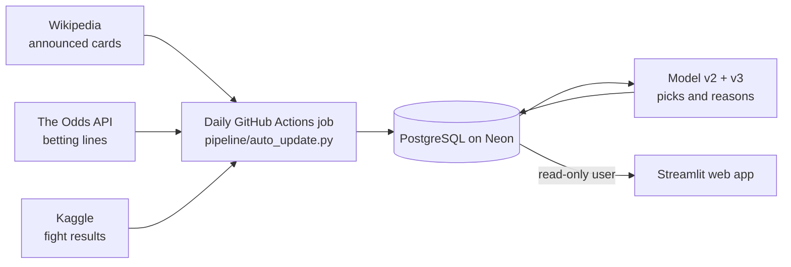

# UFC Fight Predictor

A web app that predicts UFC fights **before they happen**, locks each pick with a timestamp, explains it in plain language, and grades itself against the real results. A daily job keeps it running: it loads newly announced cards, locks picks, and grades finished events.

**Live app: https://ufc-predictor.streamlit.app/**

> Independent project, not affiliated with the UFC. Predictions are for fun and learning, not betting advice. The app never shows betting odds.

## At a glance

| | |
|---|---|
| **What it does** | Picks a winner for every UFC fight, past and upcoming, and shows the reasoning behind each pick |
| **Best result** | **65.4%** of 5,279 fights picked correctly (2016 to 2026), every pick made using only data from before that fight. A coin flip is 50% |
| **Stack** | Python (pandas, scikit-learn), PostgreSQL on Neon, SQL window functions, Streamlit, GitHub Actions |
| **Automation** | A daily job reads announced cards (Wikipedia), betting lines (The Odds API) and results (Kaggle) |
| **Safety** | 37 offline tests run before every scheduled job, a dry-run mode, and a read-only database user behind the public app |
| **Cost** | Free tiers only |

## What this project is really about

Most fight-prediction projects end with a notebook and one accuracy number. This one tries to answer a harder question: **how would I know that number is real?**

- **Time-honest evaluation.** Every pick, past or future, uses only information that existed before the event, and I check that by recomputing features the slow way and by walking forward year by year.
- **A locked record.** Picks for upcoming cards are saved with a timestamp before the event and can never be changed. The site's Track record page grades them.
- **Explanations that are exact.** The model is a sum, so each pick can be split into reasons that add up to the pick, and a reason is only saved if it reproduces the stored probability.

## Results, honestly

All rows are measured on the **same 5,279 fights (2016 to 2026)**, each predicted from earlier fights only.

| Predictor | Right |
|---|---|
| Coin flip | 50% |
| Statistical model alone (v2) | 61.8% |
| Bookmakers' opening line alone | 64.9% |
| **Statistical model + the betting market (v3)** | **65.4%** |

The market-informed model helps most where the statistics are thinnest:

| Fighters' UFC history | Fights | Model alone | Model + market |
|---|---|---|---|
| Both have 3+ UFC fights | 2,731 | 62.6% | 65.7% |
| The less experienced has 1 to 2 | 1,466 | 62.3% | 63.8% |
| A fighter is a debutant | 1,082 | 59.2% | 67.2% |

**How to read this honestly**

- **The market is doing most of the work.** The blend puts about 71% of its weight on the betting market and 29% on my model. The model alone is still a legitimate 61 to 62% predictor, but I would not claim to beat the bookmakers on my own.
- **The probabilities are honest.** Picks stated at 80% or more were right 86.9% of the time (497 fights). The 60 to 70% bucket was a little optimistic (stated 65%, right 61.8%).
- **The market and the model disagree on about a quarter of fights** (25.5%). In those fights the blended pick was right 57.1% of the time and the model-only pick 42.9%, which is the clearest evidence the market adds information the statistics do not have.
- **The backtest uses opening lines.** Live picks lock two days before an event using that day's line, so I expect results between the opening-line figure above and the closing-line figure (67.0% for the line alone, 67.6% blended), not better than either.
- **One card is noise.** A card has 10 to 14 fights, so a single event can land anywhere. The yearly accuracy of the model ranges from about 54% to 70%.

## The mistakes it caught

The most useful part of this project was catching results that looked good and were not.

1. **Career stats were snapshots of today.** The raw dataset's career stats were identical on a veteran's 2008 row and his 2026 row, so using them would have leaked the future. I rebuilt every rolling stat from earlier fights only, wrote a brute-force check that recomputes features the slow way for 300 random rows, and rebuilt the same features as SQL window functions, verified to match pandas exactly across all 17,122 fighter-fights.
2. **The first-listed fighter won every fight.** A model would have learned "pick fighter 1" and scored a fake 100%. The fighters' slots are randomised, and the model has no intercept, so swapping A and B flips its prediction exactly.
3. **A +14 point result that was leakage.** Adding the dataset's `ranking` column lifted accuracy on ranked fights from 65.4% to 79.3%, far above anything else I had measured. That was too good to believe (the betting market itself is right about 65 to 67% of the time overall). Retired champion Khabib Nurmagomedov had no ranking in any of his title fights, and Alexander Volkanovski showed as champion in his first UFC fights in 2016. The column was a snapshot of today's rankings, so it encoded who succeeded later. I discarded it. Later, with a different dataset that has genuine pre-event rankings, they added nothing (61.9% against 61.7%).
4. **An explanation that contradicted itself.** My first "Why this pick?" panel showed an Elo line that pointed at the lower-rated fighter 100% of the time. Elo, strength of opposition and win rate all measure "how good is this fighter", so the fitted model splits the credit between them in ways that look backwards one by one. I measured the problem, merged the overlapping factors (the contradiction rate dropped from 100% to about 2%), and the panel now flags any bar that still opposes every number beside it as a "net effect".
5. **Claims I had to retract.** I first assumed the dataset had no betting odds. The columns exist but are empty, which is why I went looking for another source. A "reach unknown" flag looked predictive but leaks information (reach is recorded partly based on how long a fighter lasted), so it is out.

## How the model evolved

| Version | What changed | Result |
|---|---|---|
| **v1** | Logistic regression on rolling differences, only for fights where both fighters had 3+ UFC fights | 67.2% on a 516-fight test window (about 63 to 71%); 62.8% walk-forward over 2,740 fights. The recent window was a good stretch; the long-run figure is the honest one |
| **v2** | Trained on every earlier fight, small-sample shrinkage (thin stats are pulled toward the average), Elo rating and strength of opposition, age and layoff curves. A pick for every fight | 61.4% against 60.3% for v1 over 6,276 fights (2014 to 2026), with better-calibrated probabilities and picks for debutants |
| **v3** | v2 plus the betting market, combined with a small stacker trained only on earlier fights | 65.4%, as above |

**Ideas I tested and rejected** (each with the same year-by-year validation): gradient boosting (60.6% against 61.4%, worse), fighter-style matchup features and momentum features (61.1 to 61.4%, no gain), weight-class interactions and different Elo speeds (no change), recalibrating the probabilities (already honest), and tuning regularisation (+0.3 points, borderline). With this data the algorithm is at its ceiling. The one thing that moved the number was new information: the betting market.

## How a pick is made

The model works on the **difference** between the two fighters across about 25 inputs (age, win rate and streak, striking and takedown rates, reach, Elo and the level of opponents faced). Each input adds or subtracts a little confidence, and the total becomes a probability.

Example, from a real card (Krylov vs. Yakhyaev, UFC 333): the statistical model gave Yakhyaev 59% (+0.36 in log-odds) and the betting market gave him 81% (+1.45). The blend is 0.41 x 0.36 + 0.99 x 1.45 = +1.59, which is **83%**.

## Architecture

The daily job (`pipeline/auto_update.py`) runs six steps, and one failing never blocks the others:

1. **Cards:** reads the schedule and announced fight cards from Wikipedia.
2. **Model-only picks:** locks a pick for every newly announced bout.
3. **Betting lines:** fetches the market's line for each bout and saves a time-stamped snapshot into a private odds history.
4. **Market-informed picks:** locks them two days before each event, using that day's line.
5. **Results:** downloads results, grades the locked picks, and scores the new fights.
6. **Weekly:** refreshes the historical odds dataset and extends the backtest.

### Built to be careful

An unattended job that writes to a database needs guardrails, so these are deliberate:

- **It never guesses a name.** An unmatched or near-miss fighter name is held for human review. Only a name with no similar fighter becomes a debutant.
- **A card that suddenly shrinks is refused**, because that is more likely a parsing problem than real.
- **Locked picks never change.** A pick is made before its event, and the lock is enforced in code.
- **Dry-run first.** Every step can run in a mode that reports and writes nothing.
- **Offline tests run before every scheduled job**, so a broken page reader stops the job before it writes anything. There are 37, covering name matching, page parsing, the betting-line maths, and that reasons add up to picks.
- **Least privilege.** The public app connects with a read-only database user, I confirmed writes are refused, and the private odds table is hidden even from that user. The owner connection string lives only in GitHub's encrypted secrets, and the public app holds only the read-only one.
- **Anything that needs a person ends the run with a non-zero exit code**, so GitHub emails me.

## First live test

UFC 333 (October 24, 2026) is the first card whose picks were locked before the event: 14 model-only and 14 market-informed. The live record, graded as results arrive, is on the app's **Track record** page.

<!-- After UFC 333 is graded, replace the paragraph above with the real result, for example:
"UFC 333: the model-only picks went X of 14 and the market-informed picks Y of 14. A single card is a small sample." -->

## Limitations

- **The big backtest is after the fact.** Every backtest pick uses only earlier data, but it is generated after the result. The genuinely pre-fight record started in October 2026 and is still small.
- **History is UFC-only.** A fighter's career before the UFC is not in the data. For a debutant who is not in the dataset yet, the model does not know their age or size, so those picks lean on the market.
- **The betting lines come from a third-party dataset** (opening lines, 2013 to October 2026). The project now saves its own daily snapshots, so the history grows from here.
- **Rankings, injuries and style matchups are not inputs.** Point-in-time rankings were tested and added nothing; the model knows nothing about injuries, camps, or how two styles fit together (the market, where used, may).
- **It is not betting advice**, and the site never displays odds. Lines are used only as a forecasting input.

## What I would do next

- Test whether my own captured lines can extend the market-informed model past the downloaded dataset.
- Test line movement, the change between a fight's first and last line, as a signal by itself.
- Add fighters' pre-UFC records, the best remaining fix for debutants.
- A head-to-head page where any two fighters can be compared.

## Earlier stage: a Power BI dashboard

The first version of the scoreboard was a Power BI dashboard on the same database (the file is not included because it contains a database address; `docs/powerbi_dashboard.md` explains how to rebuild it).

## Run it yourself

See the **[runbook](docs/RUNBOOK.md)** for the commands, the schedule setup, and the project layout.

## Data and credits

Fight data: the Kaggle dataset `scarekrow/ufc-data`, originally collected from ufcstats.com. It is independently collected and not endorsed by the UFC or ufcstats.com. Its ranking columns are snapshots at scrape time, so this project does not use them.

Betting lines: the UFC Data set by N. Bair, version 0.1.1, licensed CC BY 4.0 (https://github.com/nlbair/ufc-data). It was built from ufcstats.com, MMA Decisions, BestFightOdds, the Kaggle dataset `martj42/ufc-rankings` and the UFCalendar rankings API; those sources should be credited as well. Cite: Bair, N. (2026). *UFC Data: scorecards, round statistics, and betting odds, 2013 to 2026* (Version 0.1.1) [Data set]. Zenodo. https://doi.org/10.5281/zenodo.23458636. Changes made here: only the fight id, fighter ids and names, and the opening and closing win probabilities were used.

Announced cards: the schedule and fight cards are read from Wikipedia (https://en.wikipedia.org; text under CC BY-SA 4.0; only names, dates and weight classes are used). Live betting lines: The Odds API (https://the-odds-api.com), used only as a forecasting input.

This project is independent and is not affiliated with or endorsed by the UFC.
